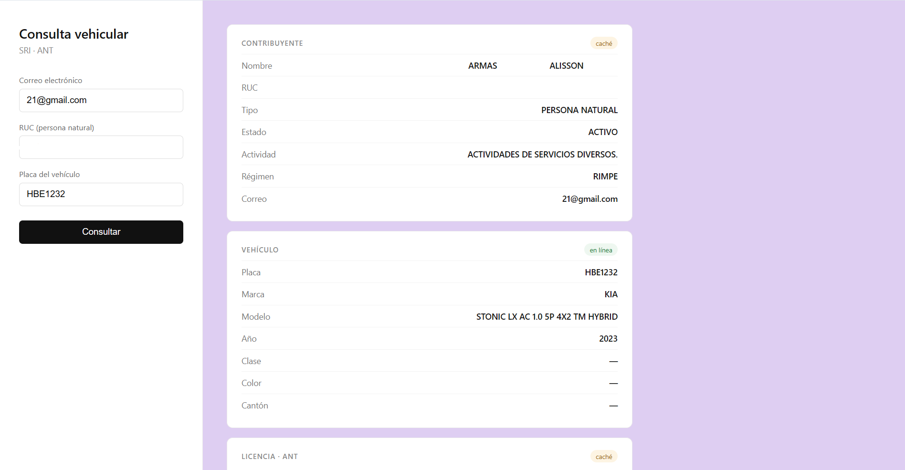

# Consulta Vehicular – SRI y ANT


Sistema web que, a partir del **correo**, el **RUC** y la **placa** de una persona natural:

1. Verifica en el **SRI** que sea contribuyente y persona natural.
2. Muestra la información del contribuyente.
3. Consulta los datos del **vehículo** en el SRI.
4. Consulta los **puntos de la licencia** en la ANT.

Como el portal de la **ANT tiene muy baja disponibilidad**, el sistema aplica el patrón **Circuit Breaker + Cache**: cada respuesta correcta se guarda en una caché en la nube y se devuelve desde allí cuando la ANT no responde.

---

## Arquitectura (modelo C4)

| Nivel | Dónde verlo |
|---|---|
| Diagrama Completo | [IcePanel]https://s.icepanel.io/Os48xhYAeFsgfA/rEFX |
| C1 – Contexto | [IcePanel]https://s.icepanel.io/Os48xhYAeFsgfA/rEFX |
| C2 – Contenedores | [IcePanel]https://s.icepanel.io/Os48xhYAeFsgfA/pzgF |
| C3 – Componentes (ms-sri) | [IcePanel]https://s.icepanel.io/Os48xhYAeFsgfA/8UGb |
| C3 – Componentes (ms-ant) | [IcePanel]https://s.icepanel.io/Os48xhYAeFsgfA/dPqs |
| C4 – Código | [docs/c4-nivel4-codigo.md](docs/c4-nivel4-codigo.md) |

### Contenedores

| Contenedor | Tecnología | Puerto | Responsabilidad |
|---|---|---|---|
| `frontend` | React + Vite | 5173 | Interfaz: formulario y resultados |
| `ms-sri` | Java 21 · Spring Boot 4 | 8081 | Contribuyente y vehículo (APIs REST del SRI) |
| `ms-ant` | Java 21 · Spring Boot 4 | 8082 | Puntos de licencia (portal ANT) |
| Caché Cloud | Redis Cloud | – | Guarda las respuestas correctas del SRI y la ANT |

---

## Patrones de diseño

### ms-sri → Cache-Aside
1. Busca primero en Redis.
2. Si no está, consulta la API del SRI.
3. Guarda el resultado en Redis (24 horas).

### ms-ant → Circuit Breaker + Cache
- **Cuando la ANT responde bien:** la respuesta se guarda en Redis y se devuelve desde allí.
- **Cuando la ANT falla:** se devuelve la última copia guardada (`fuente: CACHE`).
- **Circuit Breaker:**
  - `CERRADO` → las llamadas pasan normalmente.
  - `ABIERTO` → después de **3 fallos seguidos** no se llama a la ANT durante **20 segundos**; se responde desde la caché.
  - `SEMIABIERTO` → pasado ese tiempo se prueba una llamada; si funciona, vuelve a `CERRADO`.

> **Nota:** el portal de la ANT no está disponible de forma confiable, por lo que se **simula** (modo `SIMULADO`, con un 50% de fallos aleatorios) para demostrar el patrón. Para usar el portal real, cambiar `app.ant.modo` a `REAL` en `ms-ant/src/main/resources/application.yml`.

---

## Estructura del repositorio

```
├── docs/
│   └── c4-nivel4-codigo.md     # Diagramas de clases (C4 nivel 4)
├── frontend/                   # SPA en React
├── ms-sri/                     # Microservicio SRI (Spring Boot)
└── ms-ant/                     # Microservicio ANT (Spring Boot)
```

---

## Endpoints

| Microservicio | Método | Ruta | Descripción |
|---|---|---|---|
| ms-sri | GET | `/api/sri/contribuyentes/{ruc}` | Verifica contribuyente y persona natural |
| ms-sri | GET | `/api/sri/vehiculos/{placa}` | Información del vehículo |
| ms-ant | GET | `/api/ant/licencias/{cedula}?placa=` | Puntos de licencia |
| ms-ant | GET | `/api/ant/estado-circuito` | Estado actual del Circuit Breaker |

Cada respuesta incluye el campo **`fuente`**, que indica de dónde vino el dato: `SRI`, `ANT_SIMULADO` o `CACHE`.

---

## Cómo ejecutar

### Requisitos
- Java 21 (o 17+)
- Node.js 20+
- Una base de datos gratuita en [Redis Cloud](https://redis.io/try-free/)

### 1. Configurar la caché
Cada microservicio lee la conexión desde la variable de entorno `REDIS_URL`:
```
REDIS_URL=redis://default:<CONTRASEÑA>@<HOST>:<PUERTO>
```
> Por seguridad, la contraseña **no se incluye en el repositorio**. Usa la de tu propia base de Redis Cloud.

### 2. Levantar ms-sri (PowerShell)
```powershell
cd ms-sri
$env:REDIS_URL="redis://default:<CONTRASEÑA>@<HOST>:<PUERTO>"
.\mvnw spring-boot:run
```

### 3. Levantar ms-ant (otra ventana de PowerShell)
```powershell
cd ms-ant
$env:REDIS_URL="redis://default:<CONTRASEÑA>@<HOST>:<PUERTO>"
.\mvnw spring-boot:run
```

### 4. Levantar el frontend (otra ventana)
```powershell
cd frontend
npm install
npm run dev
```

### 5. Abrir
http://localhost:5173

---

## Cómo probar la caché
1. Llenar correo, RUC y placa y presionar **Consultar**.
2. En el bloque **Licencia · ANT**, presionar varias veces **Actualizar puntos**.
3. La etiqueta cambia entre **en línea** (la ANT respondió y se guardó en caché) y **caché** (la ANT falló y se devolvió la última copia).
4. En la consola de `ms-ant` se ve el estado del circuito: `ABIERTO`, `SEMIABIERTO` o `CERRADO`.

---

## Autora
Alisson Armas – Diseño y Arquitectura de Software
